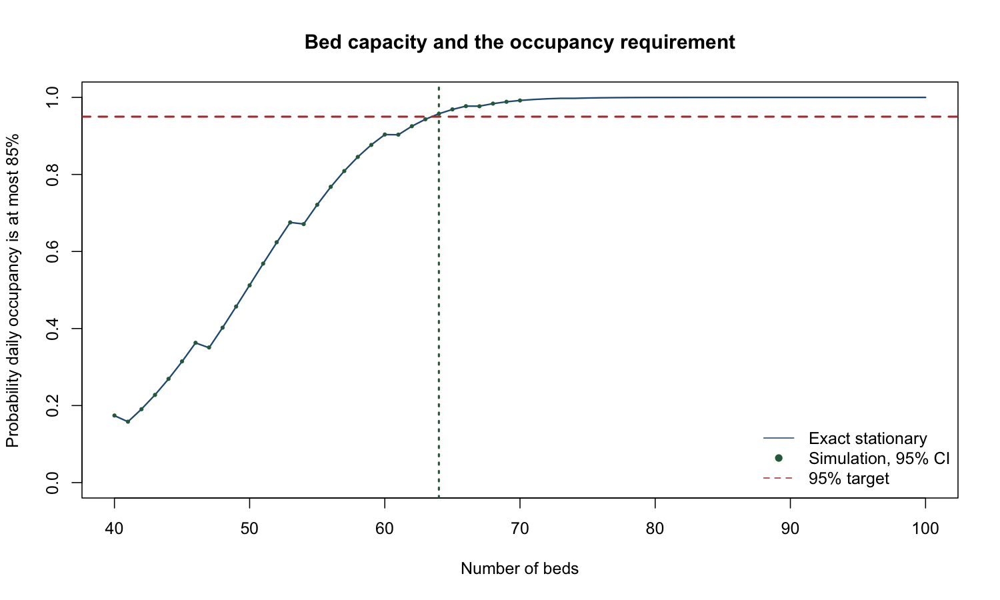
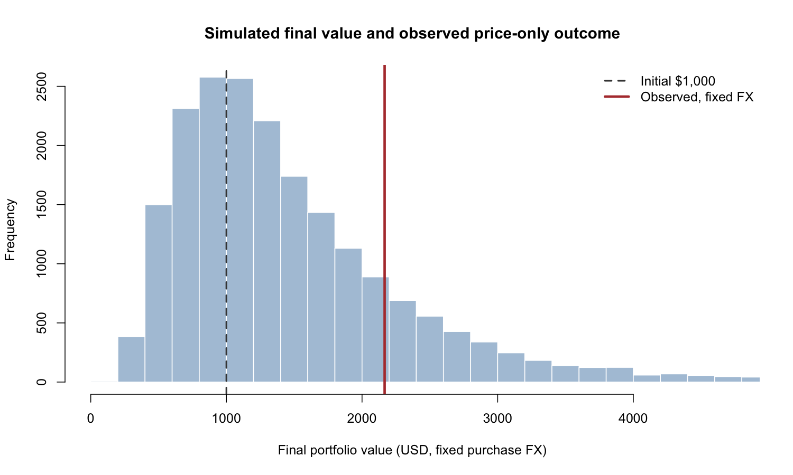

# Monte Carlo Risk Analysis

An R-based academic project examining uncertainty in hospital capacity and stock returns. Completed for **AMI22Z: Risk Analysis**, Home Assignment 2, at Dalarna University, Sweden, during my Data Science master's studies.

The project combines Monte Carlo simulation, analytical checks, sensitivity analysis and visual reporting. It distinguishes simulation precision from uncertainty in the underlying model and future outcomes.

## Start here

- [Final report](report.pdf)
- [Analysis script](analysis.R)
- [Hospital summary](hospital_summary.csv)
- [Stock results](stock_results.csv)
- [Data provenance](raw/provenance.json)

## Hospital-capacity analysis

The analysis simulates occupancy and patient rejection under the assignment's hospital model. It evaluates capacities from 40 to 70 beds using 10,000 independent paths per capacity after a 365-day warm-up, and compares the threshold with an exact stationary calculation across capacities 1 to 100.

The recorded result is **64 beds** as the minimum capacity satisfying the model's requirement that occupancy be at most 85% with probability at least 95%. This is a model-dependent coursework result, not a hospital intervention or operational recommendation.



## Stock-return analysis

The analysis uses frozen Intel, SSAB-A and exchange-rate data to estimate model inputs and simulate 20,000 full daily paths in the principal stock experiment. It examines profit outcomes, sensitivity to estimation windows and volatility uncertainty through a block-bootstrap diagnostic.

The report distinguishes closing-price returns from an adjusted-close total-return proxy. Alternative estimation windows are post hoc sensitivity checks. Monte Carlo confidence intervals describe numerical precision under fitted assumptions, not all parameter uncertainty or the range of future market outcomes.



## Files

| Path | Purpose |
|---|---|
| `analysis.R` | Base-R simulation, statistical summaries, analytical checks and figure generation |
| `raw/` | Frozen source CSVs, JSON responses and provenance |
| `fetch_prices.py` | Original Yahoo Finance retrieval script |
| `hospital_results.csv` | Hospital simulation results |
| `hospital_summary.csv` | Hospital summary and selected capacity |
| `hospital_capacity_exact_check.csv` | Exact stationary capacity checks |
| `hospital_one_year_path.csv` | Example occupancy path |
| `stock_results.csv` | Principal stock simulation results |
| `stock_parameters.csv` | Estimated parameters and diagnostic intervals |
| `stock_sensitivity.csv` | Sensitivity results |
| `stock_histogram.csv` | Recorded histogram values |
| `figures/` | Six existing analysis figures |
| `report.pdf` | Final academic report |

## Running the existing analysis

The analysis uses base R and the included frozen input files. No extra R packages or fresh data download are required.

From the repository folder:

```bash
Rscript analysis.R
```

Alternatively, open `analysis.R` in RStudio and use **Source**. When running selected lines, first set the working directory to the repository folder.

The script uses fixed random seeds and writes the result tables and figures into the repository folder. A rerun replaces the corresponding local output files. Runtime depends on the machine.

`fetch_prices.py` is included to document data acquisition. It is not needed to run the analysis. Rerunning it can replace the frozen inputs with revised market data and therefore change the resulting calculations.

## Recorded execution and interpretation

The existing project documentation records execution of the final script with **R 4.5.2 on 31 October 2026**. The repository includes the resulting files. They were copied from the completed local package without rerunning the analysis during publication preparation.

Hospital results depend on the assumed arrival and service processes and the selected capacity criterion. Stock results depend on the fitted return model, input period and treatment of prices and exchange rates. Neither set of results establishes certainty about future outcomes.

## Contribution and academic context

The original submission retains its Group 15 academic attribution. Al Amin Alif performed the project's implementation and analysis.

This repository preserves the existing analysis, frozen inputs, result tables, figures and final report. Earlier presentation drafts and review-working files are excluded so readers can navigate directly to the completed study.

Market data originates from Yahoo Finance and the underlying providers. The project does not claim authorship of those source data.

## Skills demonstrated

R, Monte Carlo simulation, probability modelling, capacity analysis, financial time series, sensitivity analysis, bootstrap methods, analytical validation and quantitative reporting.
